# Entity-Relationship Diagram (ERD) Kanonis EduMotion

Diagram ini merangkum relasi inti antara identitas/tenant, taksonomi kurikulum, hierarki tunggal pembelajaran, Question Authoring berversi, Journey Template Snapshot, Assessment Snapshot, Mastery & XP Ledger, serta Transactional Outbox.

```mermaid
erDiagram
    TENANTS ||--o{ USERS : employs_or_enrolls
    TENANTS ||--o{ SCHOOL_CLASSES : owns
    TENANTS ||--o{ QUESTIONS : scaffolds
    USERS ||--o{ AUTH_REFRESH_TOKENS : holds
    USERS ||--o{ PARENT_STUDENT_LINKS : parent_links
    USERS ||--o{ USER_JOURNEY_PREFERENCES : configures
    USERS ||--o{ JOURNEY_CHAPTER_SNAPSHOTS : freezes_per_chapter
    USERS ||--o{ JOURNEY_TEMPLATE_UNLOCKS : earns_or_unlocks
    USERS ||--o{ USER_NODE_PROGRESS : completes
    USERS ||--o{ XP_LEDGER : appends_immutable
    USERS ||--o{ COMPETENCY_MASTERY_CURRENT : tracks
    USERS ||--o{ COMPETENCY_MASTERY_EVIDENCE : records
    USERS ||--o{ ASSESSMENT_SESSIONS : attempts
    USERS ||--o{ AUDIT_LOGS : triggers

    CURRICULA ||--o{ CURRICULUM_VERSIONS : versions
    CURRICULUM_VERSIONS ||--o{ LEARNING_PATHS : grounds
    SUBJECTS ||--o{ TOPICS : contains
    TOPICS ||--o{ COMPETENCIES : defines
    SUBJECTS ||--o{ LEARNING_PATHS : categorizes
    GRADE_LEVELS ||--o{ LEARNING_PATHS : levels

    LEARNING_PATHS ||--o{ JOURNEY_CHAPTERS : contains_ordered
    JOURNEY_CHAPTERS ||--o{ JOURNEY_NODES : contains_ordered
    JOURNEY_CHAPTERS ||--o{ JOURNEY_CHAPTER_SNAPSHOTS : snapshotted_for
    JOURNEY_TEMPLATE_CATALOG ||--o{ JOURNEY_CHAPTER_SNAPSHOTS : instantiates
    JOURNEY_NODES ||--o{ NODE_ACTIVITY_MAPPINGS : links
    ACTIVITIES ||--o{ NODE_ACTIVITY_MAPPINGS : mapped_to
    ACTIVITIES ||--o{ ACTIVITY_QUESTION_MAPPINGS : delivers
    QUESTIONS ||--o{ QUESTION_VERSIONS : versions
    QUESTION_VERSIONS ||--o{ ACTIVITY_QUESTION_MAPPINGS : embedded_in
    QUESTION_VERSIONS ||--o{ QUESTION_REVIEWS : audited_by

    AI_GENERATION_RUNS ||--o{ AI_GENERATION_ITEMS : produces
    AI_GENERATION_ITEMS }o--|| QUESTIONS : promotes_to_draft_only

    ASSESSMENT_BLUEPRINTS ||--o{ ASSESSMENTS : defines
    ASSESSMENTS ||--o{ ASSESSMENT_SESSIONS : spawns
    ASSESSMENTS ||--o{ ASSESSMENT_QUESTION_SNAPSHOTS : freezes_questions
    ASSESSMENT_SESSIONS ||--o{ ASSESSMENT_RESPONSES : captures
    ASSESSMENT_SESSIONS ||--|| ASSESSMENT_RESULTS : produces

    OUTBOX_EVENTS ||--o{ PROCESSED_EVENTS : deduplicated_for
```

